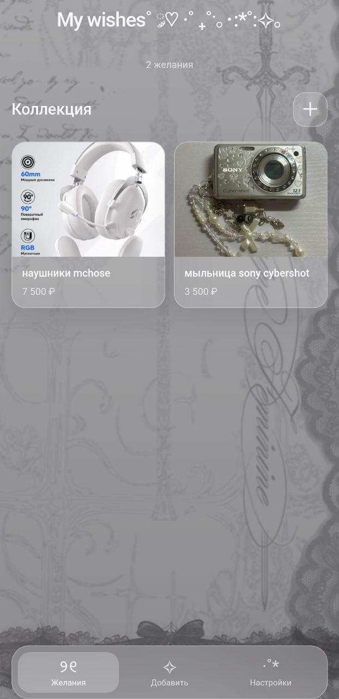
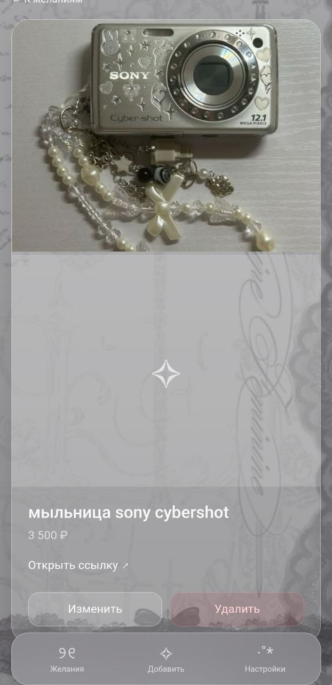

# My wishes

Android-приложение для списка желаний. Можно добавлять то, что хочется купить, с фото, ценой, ссылкой и описанием. Делала в Android Studio на Java.

## Что умеет приложение

- добавлять желание (название, цена, ссылка, описание, фото из галереи)
- смотреть все желания в виде карточек
- открывать желание и смотреть подробную информацию
- редактировать и удалять желания (перед удалением спрашивает подтверждение)
- переключать три темы оформления: светлую, тёмную и розовую
- ставить свою картинку на фон отдельно для каждой темы и возвращать стандартный фон
- показывать счётчик желаний (с правильным склонением: 1 желание, 2 желания, 5 желаний)
- хранить всё на телефоне, данные не пропадают после закрытия приложения

## Скриншоты приложения 




## Как устроено

Приложение сделано через `WebView`. Внешний вид написан на HTML и CSS, а вся логика написана на Java.

- **HTML и CSS** отвечают только за то, как всё выглядит. Кнопки в HTML при нажатии вызывают методы Java.
- **Java** делает всё остальное: переключает экраны, проверяет форму, сохраняет и удаляет желания, меняет тему и фон, достаёт фото из галереи.

Как они общаются между собой:

1. Нажатие на кнопку в HTML вызывает метод из класса `Bridge` (он помечен `@JavascriptInterface`), например `Android.saveWish(...)`.
2. Java что-то делает с данными.
3. Потом Java обновляет страницу через `webView.evaluateJavascript(...)`. Например, собирает HTML карточек и вставляет его в список.

Полностью без JavaScript обойтись нельзя, потому что Java может менять страницу только через `evaluateJavascript`. Но самой логики в JS нет, там только вызовы Java.

## Структура проекта

```
app/src/main/
├── assets/
│   ├── index.html      разметка экранов
│   └── style.css       оформление
├── java/com/example/wishlist/
│   ├── MainActivity.java   вся логика приложения
│   └── Wish.java           класс одного желания
└── res/layout/
    └── activity_main.xml   один WebView на весь экран
```

### Wish.java

Модель данных. Хранит id, название, цену, ссылку, описание, фото и дату создания. Умеет превращаться в JSON и обратно (`toJson` и `fromJson`).

### MainActivity.java

Главный класс. Основные части:

- `Bridge` принимает нажатия из HTML
- `showScreen` переключает экраны (список, форма, детали, настройки)
- `renderWishes` собирает карточки и показывает их на странице
- `onSaveWish` проверяет название и ссылку, потом создаёт или обновляет желание
- `loadWishes` и `saveWishes` читают и записывают список в `SharedPreferences`
- `encodeImage` уменьшает выбранную картинку и превращает её в строку base64, чтобы показать в WebView
- `applyTheme` включает выбранную тему (светлая, тёмная или розовая), сохраняет её и ставит фон этой темы
- `applyBackground` и `backgroundKey` отвечают за фон: у каждой темы он хранится отдельно в `SharedPreferences`
- `OnBackPressedCallback` для кнопки «Назад»: сначала возвращает на главный экран, и только потом закрывает приложение

## Где хранятся данные

Список желаний сохраняется в `SharedPreferences` в виде JSON. Там же лежат настройки темы и фона. Фото сжимаются перед сохранением (до 800 px, фон до 1280 px), чтобы не занимали много места.

## Обои для тем

У тёмной и розовой темы есть свои обои по умолчанию. Чтобы они появились, нужно положить в папку `assets` картинки `background_dark.jpg` и `background_pink.jpg`. Если файлов нет, показывается обычный градиент.

Кроме этого, в настройках можно выбрать свою картинку из галереи. Она запоминается только для текущей темы.
## Как запустить

1. Открыть проект в Android Studio.
2. Проверить, что `index.html` и `style.css` лежат в папке `app/src/main/assets/` (если папки нет, создать: правый клик по `main` → New → Directory → `assets`).
3. В `activity_main.xml` должен быть `WebView` с `id` `webView`.
4. Запустить на эмуляторе или на телефоне.

## Чему научилась

- как подключать `WebView` и показывать в нём локальные HTML-файлы
- как связать Java и JavaScript через `@JavascriptInterface` и `evaluateJavascript`
- как сохранять данные через `SharedPreferences` и JSON
- как выбирать файлы из галереи через `ActivityResultLauncher`
- как уменьшать картинки через `Bitmap`, чтобы они не занимали много памяти
- как обрабатывать кнопку «Назад» через `OnBackPressedDispatcher`

## Что можно улучшить

- поворот фото по данным EXIF (сейчас некоторые фото с камеры могут открываться повёрнутыми)
- хранить фото отдельными файлами, а не строкой в `SharedPreferences`
- добавить поиск и сортировку по цене
- переписать интерфейс на обычные Android View вместо WebView
